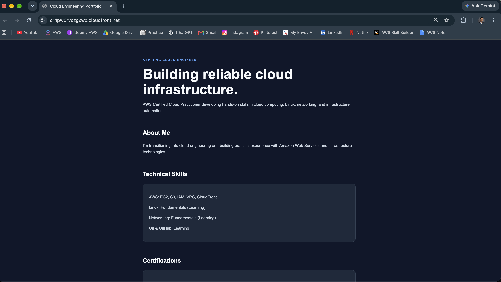
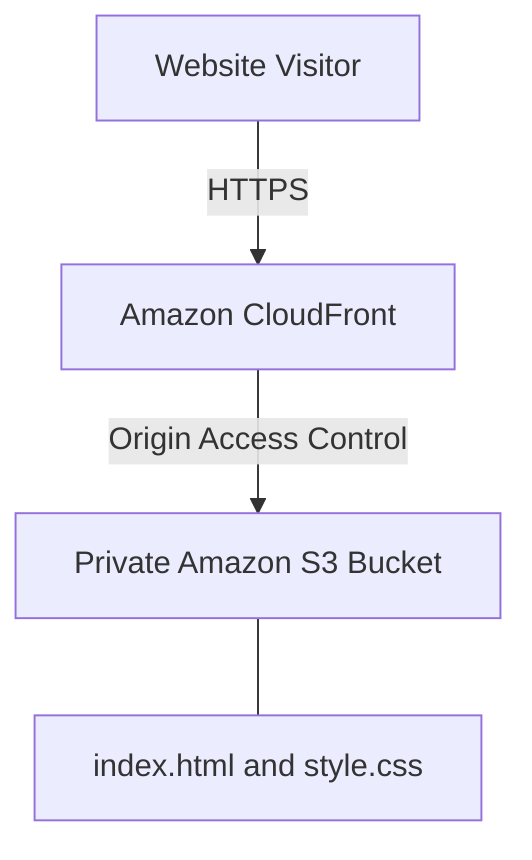

# AWS Cloud Engineering Portfolio

A personal cloud engineering portfolio website hosted on Amazon Web Services using Amazon S3 and Amazon CloudFront.

## Live Website

[View My AWS Cloud Portfolio](https://d11pw0rvczgxwx.cloudfront.net)

## Website Screenshot

  

## Project Overview

This project demonstrates how to host a static website on AWS using secure cloud storage and a global content delivery network.

The website was developed locally using HTML and CSS, uploaded to Amazon S3, and delivered publicly through Amazon CloudFront over HTTPS.

## AWS Services Used

- **Amazon S3:** Stores the website's HTML and CSS files.
- **Amazon CloudFront:** Delivers the website over HTTPS.
- **AWS IAM and resource policies:** Control access to AWS resources.
- **CloudFront Origin Access Control (OAC):** Allows CloudFront to retrieve content from a private S3 bucket.

## Architecture

  

## Security Configuration

- S3 Block Public Access enabled.
- ACLs disabled using Bucket Owner Enforced ownership.
- Bucket policy permits CloudFront to retrieve website objects.
- Access restricted to the specific CloudFront distribution using AWS:SourceArn.
- HTTPS used for public website delivery.
- S3 objects encrypted at rest using SSE-S3.

## Deployment Process

1. Created the website locally with HTML and CSS.
2. Created an S3 bucket in us-east-1.
3. Enabled S3 Block Public Access and default encryption.
4. Uploaded index.html and style.css to S3.
5. Created a CloudFront distribution with the S3 bucket as its origin.
6. Configured private S3 origin access.
7. Set index.html as the default root object.
8. Verified that the website loads through CloudFront over HTTPS.
9. Initialized Git version control and published the project to GitHub.

## Skills Demonstrated

- AWS static website deployment
- Cloud storage management
- Content delivery networks
- Basic IAM and resource-based access policies
- Cloud security fundamentals
- Git and GitHub
- HTML and CSS

## Future Improvements

- Add architecture diagrams and screenshots.
- Automate infrastructure deployment using Terraform.
- Add more cloud engineering projects to the portfolio.
- Implement an automated deployment workflow.

## Project Status

Successfully deployed on AWS. Documentation and additional enhancements are ongoing.
  